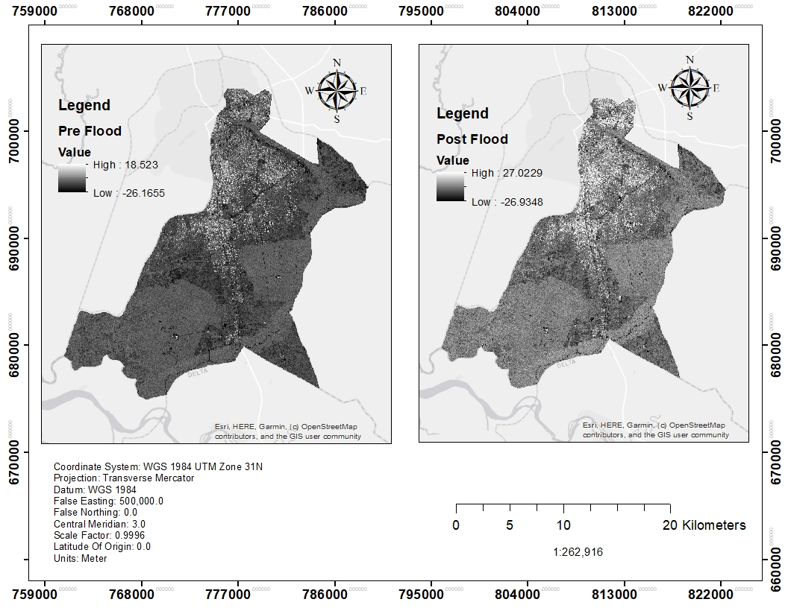
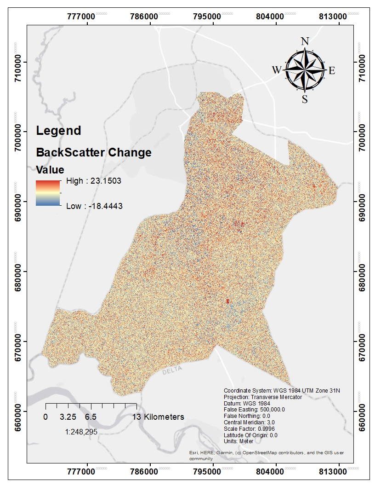
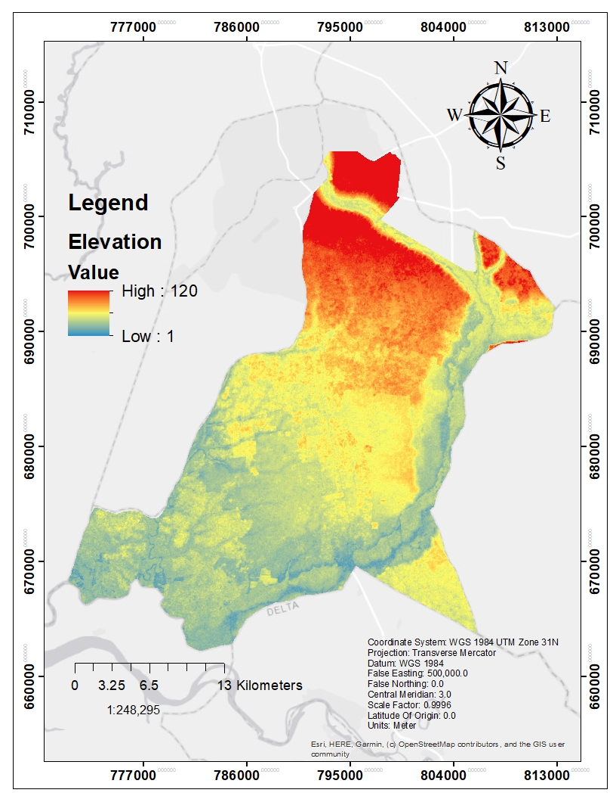
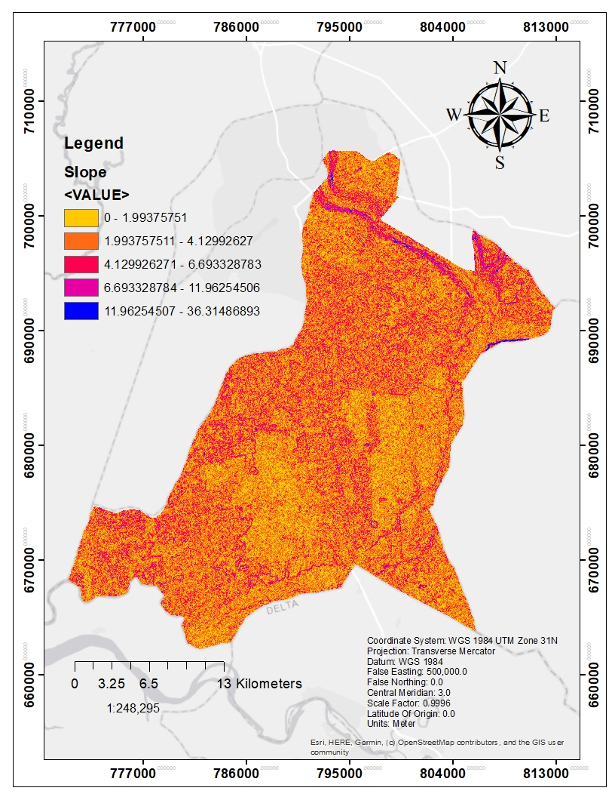
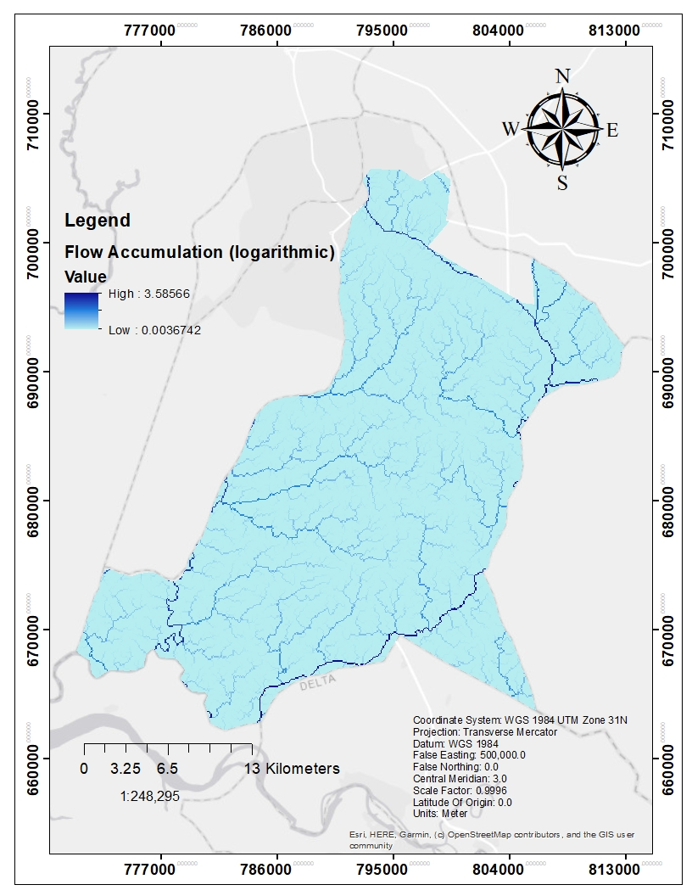
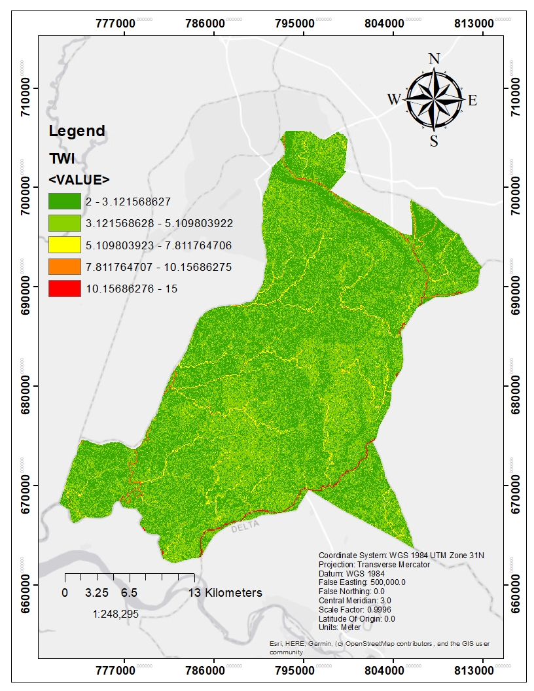
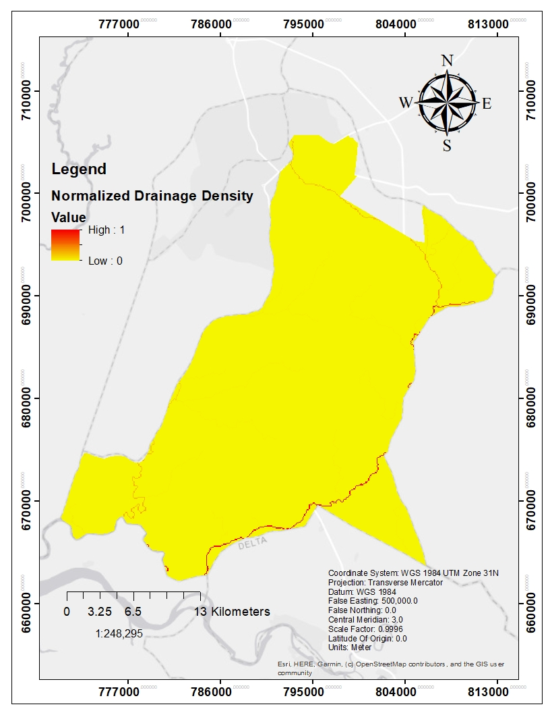
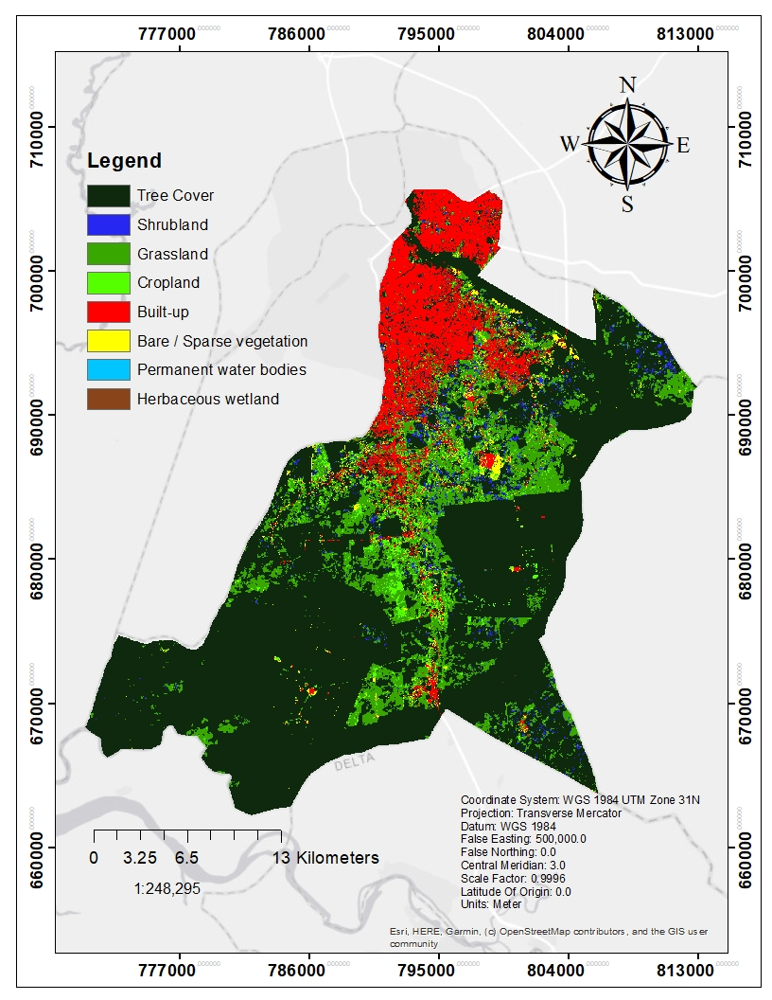
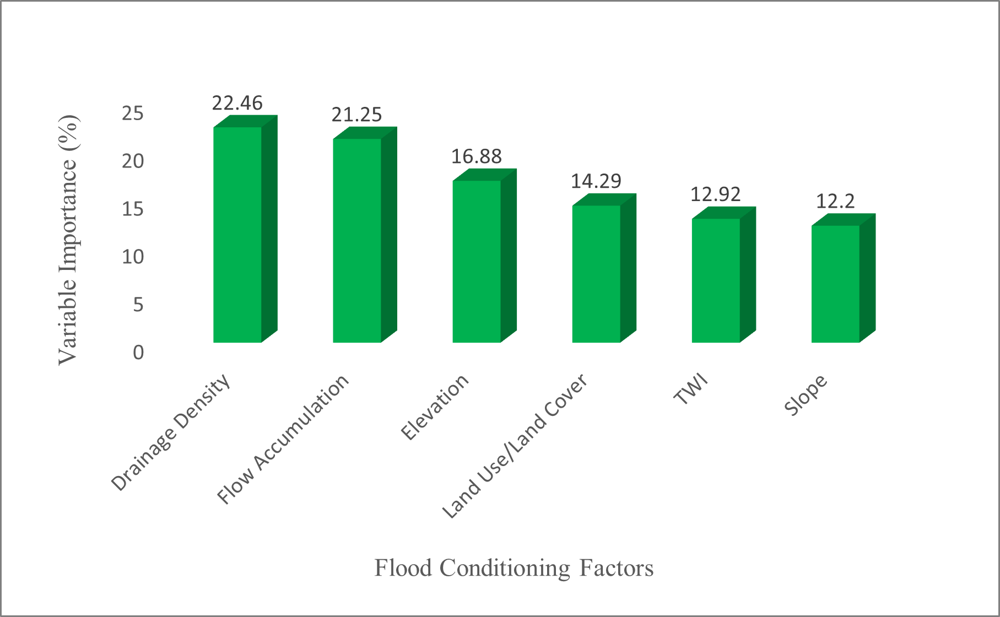
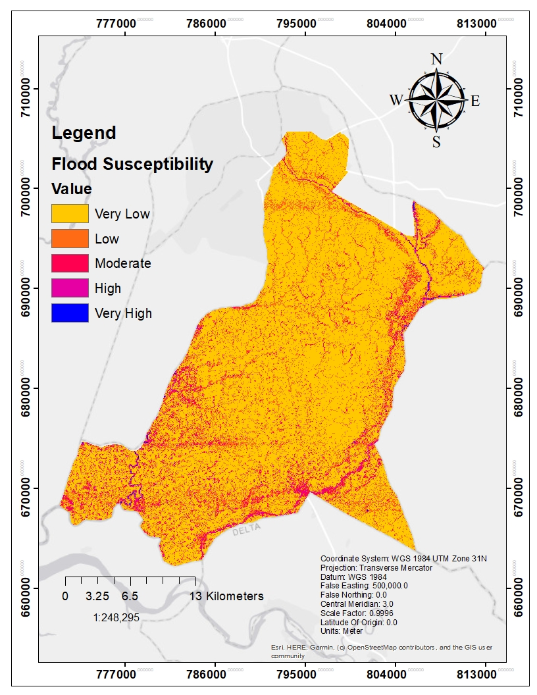

# Machine Learning-Based Flood Susceptibility Mapping Using Sentinel-1 SAR and Random Forest in Ikpoba-Okha, Nigeria

## Project Overview

This repository presents a Google Earth Engine (GEE) implementation of a machine learning-based flood susceptibility mapping framework for Ikpoba-Okha, Edo State, Nigeria.

The study integrates Synthetic Aperture Radar (SAR) imagery, terrain characteristics, hydrological variables and land use/land cover information to identify areas susceptible to flooding. Historical flood extent is extracted from Sentinel-1 SAR backscatter change detection and subsequently used as the reference dataset for training and validating a Random Forest (RF) classifier.

The resulting model produces a spatially continuous flood susceptibility surface and a classified map representing five levels of flood susceptibility.

## Study Area

The study focuses on Ikpoba-Okha Local Government Area, Edo State, southern Nigeria.

## Data Sources

| Dataset | Source | Application |
|---|---|---|
| Sentinel-1 GRD | Copernicus | Flood extent extraction and backscatter change detection |
| SRTM DEM | USGS | Elevation and slope derivation |
| MERIT Hydro | MERIT | Flow accumulation |
| ESA WorldCover 2020 | ESA | Land use/land cover classification |
| Global Surface Water | JRC | Permanent water identification |

### Sentinel-1 Image Acquisition

Sentinel-1 Ground Range Detected (GRD) imagery was acquired using Interferometric Wide (IW) mode, VV polarisation and a spatial resolution of 10 m.

- **Pre-flood period:** 1 May 2023 – 20 June 2023.
- **Post-flood period:** 1 July 2023 – 10 August 2023.

Median composites were generated for both periods.

## Methodology

### 1. Flood Inventory Generation

Historical flood extent was extracted through Sentinel-1 SAR backscatter change detection.

The difference between the post-flood and pre-flood median composites was calculated as:

$$
\Delta VV = VV_{post}-VV_{pre}
$$

A percentile-based threshold was applied to identify pixels exhibiting substantial reductions in radar backscatter.

$$
Flood =
\begin{cases}
1, & \Delta VV < P_{10}\\
0, & \text{Otherwise}
\end{cases}
$$

The initial flood inventory was refined by excluding permanent water bodies using JRC Global Surface Water, removing areas with slopes greater than 10 degrees and filtering isolated pixels using connected-pixel analysis.

### 2. Flood Conditioning Factors

Six environmental variables were incorporated into the Random Forest model.

**Elevation:** Derived from the SRTM Digital Elevation Model.

**Slope:** Calculated from the DEM using terrain analysis.

**Flow Accumulation:** Derived from MERIT Hydro using the upstream contributing area (UPA) layer.

**Normalised Flow Accumulation:** Calculated by dividing local flow accumulation by the maximum flow accumulation within the study area.

$$
D_d = \frac{FA_{local}}{FA_{max}}
$$

**Topographic Wetness Index (TWI):** Derived to represent the spatial tendency of terrain to accumulate water.

$$
TWI = \ln\left(\frac{a}{\tan\beta}\right)
$$

Where:

- $a$ represents the upslope contributing area, approximated using flow accumulation.
- $\beta$ represents the slope angle in radians.

The resulting TWI was constrained to a range of 2–15.

**Land Use/Land Cover:** Extracted from ESA WorldCover 2020 at 10 m spatial resolution.

### 3. Random Forest Modelling

A stratified random sampling approach was implemented to extract observations from the combined predictor and flood inventory dataset.

A total of 1,200 samples were targeted, comprising 600 flood observations and 600 non-flood observations. The samples were randomly divided into 70% training data and 30% validation data.

| Parameter | Configuration |
|---|---|
| Number of trees | 300 |
| Minimum leaf population | 5 |
| Bag fraction | 0.7 |
| Random seed | 42 |
| Training proportion | 70% |
| Validation proportion | 30% |

The trained classifier was evaluated using a confusion matrix, overall accuracy and Cohen's Kappa coefficient.

A second Random Forest model was configured with probability output to generate the continuous susceptibility surface. The resulting output was classified into five susceptibility categories.

### 4. Flood Susceptibility Classification

| Probability Range | Susceptibility Category |
|---|---|
| Below 0.20 | Very Low |
| 0.20–0.39 | Low |
| 0.40–0.59 | Moderate |
| 0.60–0.79 | High |
| 0.80–1.00 | Very High |

## Results and Model Evaluation

### Model Performance

The Random Forest model demonstrated strong predictive performance based on the reported validation results.

**Confusion Matrix**

| Actual / Predicted | Non-Flood | Flood |
|---|---:|---:|
| Non-Flood | 192 | 7 |
| Flood | 19 | 83 |

**Evaluation Metrics**

| Metric | Result |
|---|---:|
| Overall Accuracy | 91.36% |
| Kappa Coefficient | 0.834 |
| ROC-AUC | 0.985 |

Overall accuracy measures the proportion of correctly classified observations.

$$
Accuracy = \frac{TP+TN}{TP+TN+FP+FN}
$$

The reported ROC-AUC value indicates strong discrimination between flood and non-flood observations.

### Random Forest Variable Importance

| Predictor Variable | Importance (%) |
|---|---:|
| Flow Accumulation | 22.22 |
| Normalised Flow Accumulation | 21.00 |
| Elevation | 17.67 |
| Land Use/Land Cover | 16.37 |
| Topographic Wetness Index | 11.91 |
| Slope | 10.84 |

Flow accumulation and normalised flow accumulation were the two most influential predictors, followed by elevation and land use/land cover.

## Visualisations

### Sentinel-1 Flood Detection

**Pre-flood and post-flood composites**

**Backscatter change detection**

### Flood Conditioning Factors

**Elevation**

**Slope**

**Flow Accumulation**

**Topographic Wetness Index**

**Normalised Flow Accumulation**

**Land Use/Land Cover**

### Model Outputs and Evaluation

**Random Forest variable importance**

**Final flood susceptibility map**

## Tools and Technologies

- **Google Earth Engine:** Satellite image processing, geospatial analysis and machine learning.
- **JavaScript:** Development of the GEE processing and modelling workflow.
- **Sentinel-1 SAR:** Radar-based flood extent extraction.
- **Random Forest:** Supervised machine learning and flood susceptibility prediction.
- **Geospatial datasets:** SRTM, MERIT Hydro, ESA WorldCover and JRC Global Surface Water.

## Reproducibility

The Google Earth Engine JavaScript script contains the processing workflow, including satellite data acquisition, flood inventory generation, predictor preparation, sample extraction, model training, validation and export of susceptibility maps.

To reproduce the analysis:

1. Open the Google Earth Engine Code Editor.
2. Import or define the study area geometry as `studyArea`.
3. Copy the JavaScript script into the Code Editor.
4. Run the script and inspect the generated map layers and evaluation outputs.
5. Execute the export tasks to save the resulting datasets to Google Drive.

The analysis uses publicly accessible satellite and geospatial datasets.

## Limitations

The flood inventory was derived from Sentinel-1 backscatter change detection and therefore depends on the quality of the selected observation periods and the effectiveness of the applied threshold. The use of a single flood event for model training may also limit the model's ability to represent flood conditions under different hydrological and climatic circumstances.

Additionally, the spatial resolution and characteristics of the conditioning datasets differ, requiring attention to spatial alignment and scale during interpretation.

The resulting susceptibility map represents relative flood susceptibility rather than flood depth, inundation probability for a specified return period or a real-time flood forecast.

## Author

**Kelvin Akhere Moses**

B.Sc. Surveying and Geo-Informatics (First Class Honours)  
University of Benin, Nigeria

[LinkedIn](https://www.linkedin.com/in/kelvin-moses-90538023a/) | [Personal Portfolio](https://kelvinmoses.me)
